# SannaLMS / Edulateral — Superadmin Operational Manual

**Platform Target:** SannaLMS Multi-Tenant SaaS Platform  
**Target Role:** `SUPER_ADMIN` (Master Institutional Authority)  
**Access Portal:** [https://admin.sannalms.sannainnovations.com](https://admin.sannalms.sannainnovations.com)  
**Security Standard:** Keycloak OIDC / JWT Role-Based Access Control (RBAC)  
**Document Version:** 2026.1 (Production Baseline)  

---

## Executive Overview & Role Scope

The **Superadmin** account has root-level visibility and multi-tenant authority across all institutions hosted on SannaLMS. While College Admins are restricted to their individual campus, the Superadmin can:
1. **Onboard & Provision Institutions**: Create new colleges, assign subdomains, and generate initial tenant admin accounts.
2. **Configure Global Academic Taxonomies**: Define sessions, departments, branches, semesters, sections, and subject syllabi.
3. **Orchestrate Identities**: Batch-import users, enforce password security policies, and manage global directory records.
4. **Supervise Curricula & Offerings**: Author master courses, attach reference study materials, and govern syllabus progression.
5. **Manage the Assessment & CodeLab Suite**: Author MCQs, configure Edulateral CodeLab programmatic problems, and run real-time proctored test sessions with AST code similarity review.
6. **Oversee Operations**: Administer live classes, master academic calendars, campus attendance records, digital certificates, and emergency broadcast alerts.

---

## Table of Contents
1. [Authentication, Access Control & Security Standard](#1-authentication-access-control--security-standard)
2. [Master Dashboard & System Telemetry](#2-master-dashboard--system-telemetry)
3. [Colleges & Multi-Tenant Management](#3-colleges--multi-tenant-management)
4. [Academic Hierarchy (Taxonomy Setup)](#4-academic-hierarchy-taxonomy-setup)
5. [User Directory & Identity Administration](#5-user-directory--identity-administration)
6. [CSV Bulk User Provisioning](#6-csv-bulk-user-provisioning)
7. [Courses, Curriculum & Study Materials](#7-courses-curriculum--study-materials)
8. [Question Bank & Coding Problem Specification](#8-question-bank--coding-problem-specification)
9. [Edulateral CodeLab Live Monitor & Plagiarism Reviewer](#9-edulateral-codelab-live-monitor--plagiarism-reviewer)
10. [Online Tests, Quizzes & Assignments](#10-online-tests-quizzes--assignments)
11. [Master Gradebook & Performance Records](#11-master-gradebook--performance-records)
12. [Live Virtual Classes & Institutional Calendar](#12-live-virtual-classes--institutional-calendar)
13. [Attendance Tracking & Digital Credentials](#13-attendance-tracking--digital-credentials)
14. [Broadcast Notifications & Discussion Moderation](#14-broadcast-notifications--discussion-moderation)

---

## 1. Authentication, Access Control & Security Standard

### Accessing the Portal
Navigate to `https://admin.sannalms.sannainnovations.com`. The application verifies your authentication state against the Keycloak SSO server (`/auth/realms/sannalms`).

```
[User Browser] ---> [Admin Portal: admin.sannalms.sannainnovations.com]
                           |
                           v  (If not authenticated)
                     [Keycloak SSO]
                           |
                           v  (Issues JWT with role: superadmin)
                     [Admin Portal Unlocks Master Suite]
```

### Key Security Standards
- **Role Isolation**: Only users containing `superadmin` in their Keycloak `realm_access.roles` claim are granted master administrative access.
- **Session Lifespan**: Access tokens are verified on every API request. Background timers ensure continuous authorization without dropping state during live exam observation.
- **SEC-01 First Login Policy**: All provisioned accounts receive temporary credentials flagged with `UPDATE_PASSWORD`, forcing users to set their own confidential password upon their first sign-in.

---

## 2. Master Dashboard & System Telemetry

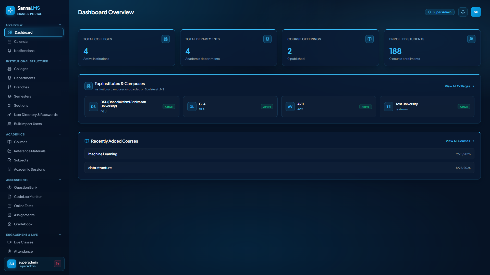
*Figure 2.1: SannaLMS Master Superadmin Dashboard with Real-Time KPIs and Tenant Overview*

### Telemetry Widgets
| Widget | Type | Purpose |
| :--- | :--- | :--- |
| **TOTAL COLLEGES** | Counter | Real-time count of all onboarded institutions. Clicking navigates directly to Colleges Management. |
| **TOTAL DEPARTMENTS** | Counter | Aggregated academic faculties configured across all active campuses. |
| **COURSE OFFERINGS** | Counter | Global master course count with published vs draft breakdown. |
| **ENROLLED STUDENTS** | Counter | Verified student accounts across all branches and cohorts. |
| **Top Institutes & Campuses** | Tenant Grid | Visual cards displaying college initials, legal title, subdomain, and active status. |
| **Recently Added Courses** | Activity Feed | Timestamped list of newly published or authored curricula. |

---

## 3. Colleges & Multi-Tenant Management

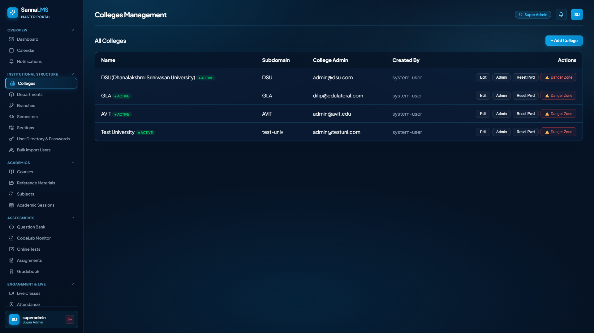
*Figure 3.1: Colleges Directory displaying subdomains, assigned admins, and administrative actions*

### Flow: Onboarding a New College / Campus
1. Click the **+ Add College** button in the upper right.
2. Complete the institution profile fields in the modal:

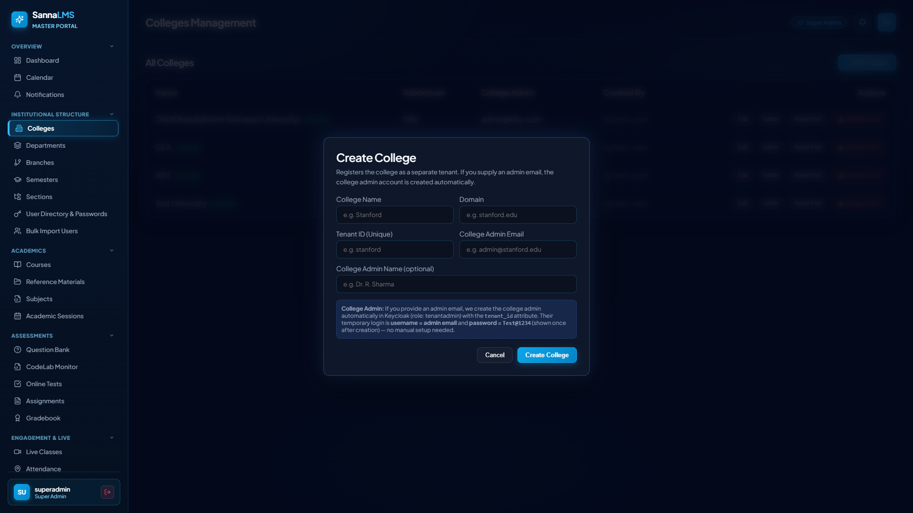
*Figure 3.2: Create College Modal displaying automated tenant admin account creation*

| Field | Required | Description |
| :--- | :--- | :--- |
| **College Name** | Yes | Full institutional name (e.g. `DSU (Dhanalakshmi Srinivasan University)`). |
| **Domain** | Yes | Academic web domain used for email matching (e.g. `dsu.edu.in`). |
| **Tenant ID (Unique)** | Yes | System-wide slug used for database tenant partitioning (e.g. `dsu`). |
| **College Admin Email** | Yes | Official email for the institution's primary admin (e.g. `admin@dsu.com`). |
| **College Admin Name** | Optional | Full contact name for administrative records (e.g. `Dr. R. Sharma`). |

> **Automated Tenant Admin Provisioning**: When a valid admin email is provided, the platform automatically registers the account in Keycloak with the `COLLEGE_ADMIN` role and assigns the initial temporary password `Test@1234`.

---

## 4. Academic Hierarchy (Taxonomy Setup)

SannaLMS implements a hierarchical organizational taxonomy:  
`College → Academic Session → Department → Branch → Semester → Section → Subject`

### Step 4A: Academic Sessions (`/academic-sessions`)
Define multi-year cohort spans (e.g., `2024–2028`, `2025–2029`). Designate the **Active Session**; all new enrollments automatically anchor to this session.

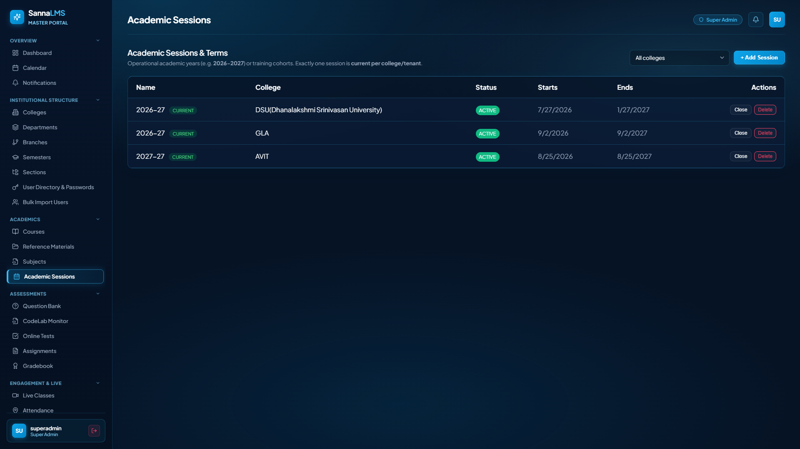
*Figure 4.1: Academic Sessions Manager with Active status toggles*

### Step 4B: Departments (`/departments`)
Create academic faculties under each college (e.g., Computer Science, Mechanical Engineering, Business Administration).

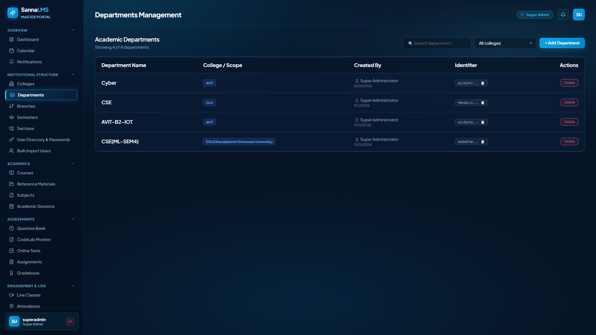
*Figure 4.2: Department Catalog with College filtering*

### Step 4C: Branches (`/branches`)
Define specific degree programs (e.g., `B.Tech Computer Science & Engineering`, `B.Tech AI & Data Science`).

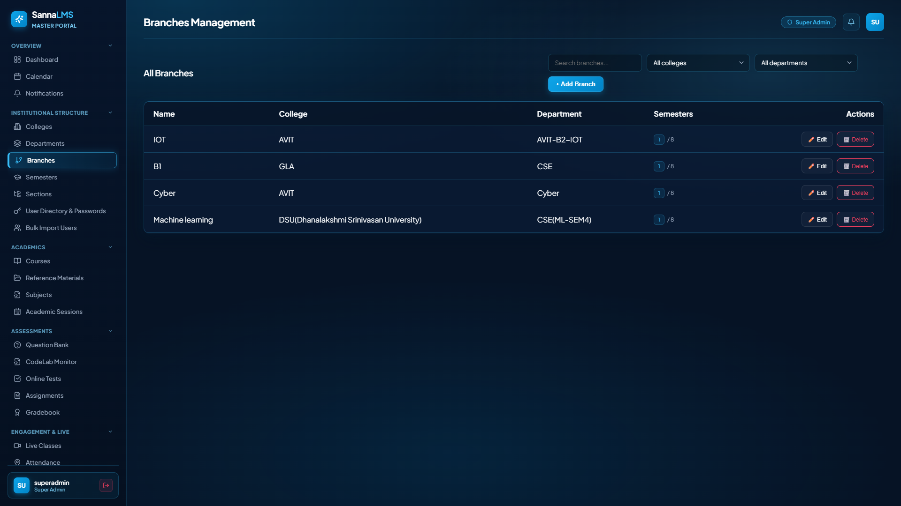
*Figure 4.3: Branches & Degree Specializations directory*

### Step 4D: Semesters & Sections (`/semesters`, `/sections`)
Provision progression levels (Semester 1 through 8) and divide cohorts into manageable class sections (`Section A`, `Section B`).

| Semesters Console | Sections Console |
| :---: | :---: |
| 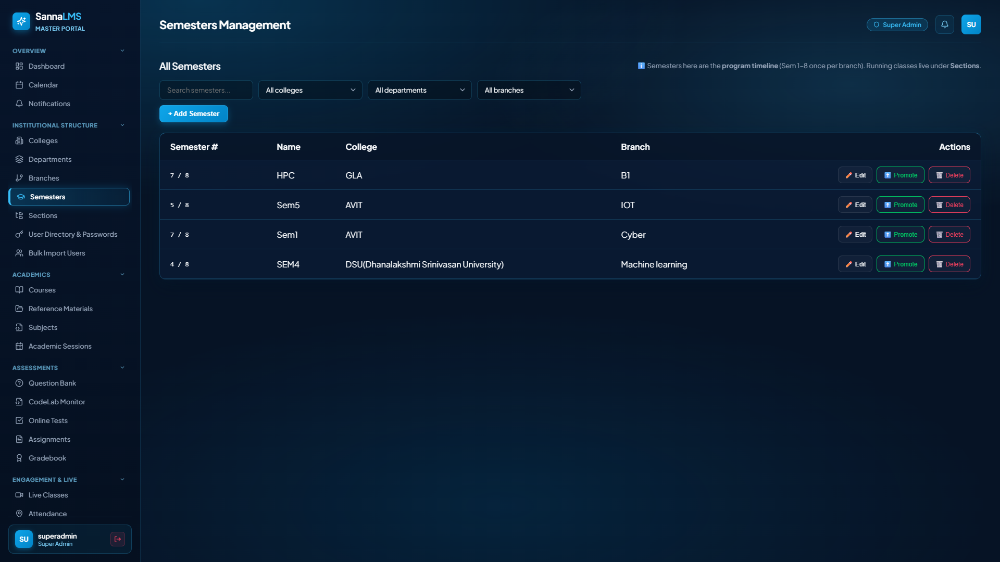 | 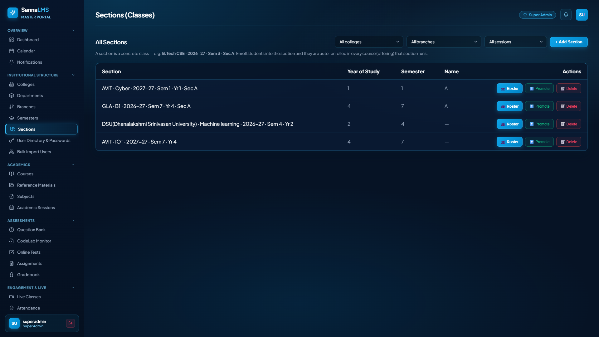 |

### Step 4E: Subjects Catalog (`/subjects`)
Build institutional course syllabi. Map subject codes, credit hours, practical lab components, and assign lead instructors.

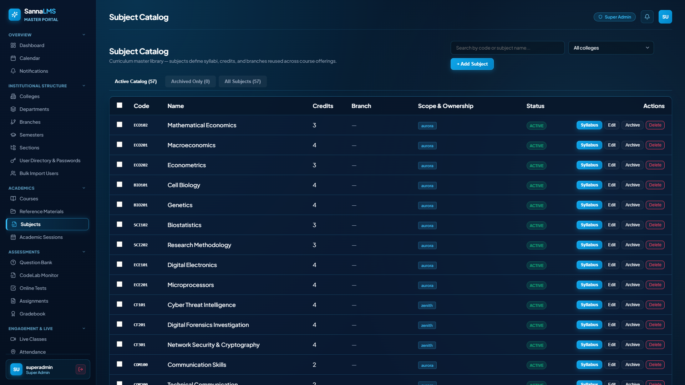
*Figure 4.6: Master Subjects Database scoped by college, branch, and semester*

---

## 5. User Directory & Identity Administration

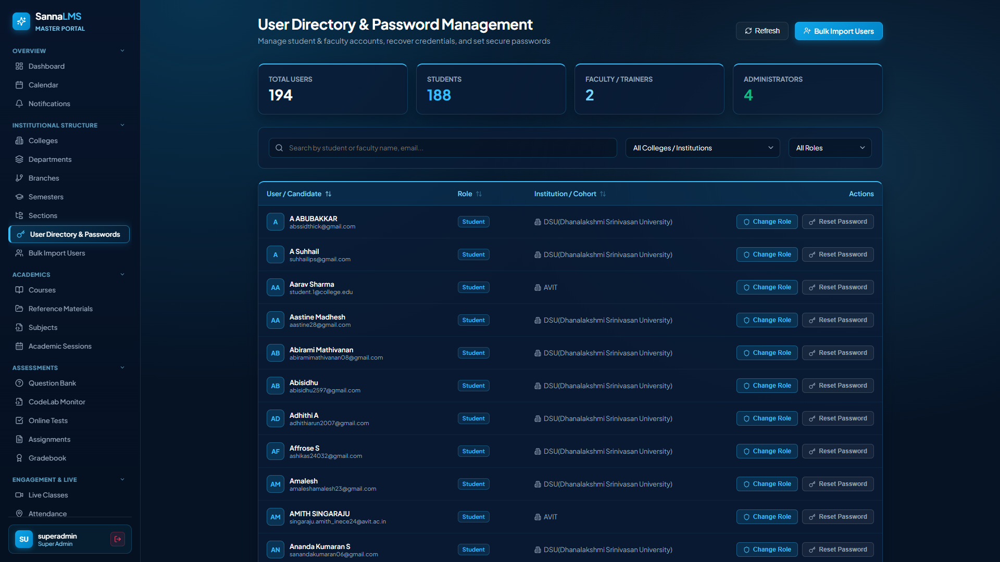
*Figure 5.1: Global User Directory with Role filtering and direct password reset triggers*

### Role Matrix
| Role Key | Display Name | Destination Portal | Capabilities |
| :--- | :--- | :--- | :--- |
| `SUPER_ADMIN` | Super Admin | Admin UI (Global) | Root authority across all campuses and system configurations. |
| `COLLEGE_ADMIN` | College Admin | Admin UI (Scoped) | Manages faculty, courses, and students within their assigned college. |
| `PRIMARY_TRAINER` | Trainer / Instructor | Admin UI (Trainer) | Authors questions, grades assessments, launches webinars, monitors CodeLab. |
| `TEACHING_ASSISTANT`| Teaching Assistant | Admin UI (TA) | Assists in assignment grading and discussion board moderation. |
| `STUDENT` | Student | Student Portal | Accesses learning content, solves CodeLab problems, submits tests. |

---

## 6. CSV Bulk User Provisioning

The Bulk Import Console enables onboarding entire student batches or faculty rosters in a single transaction.

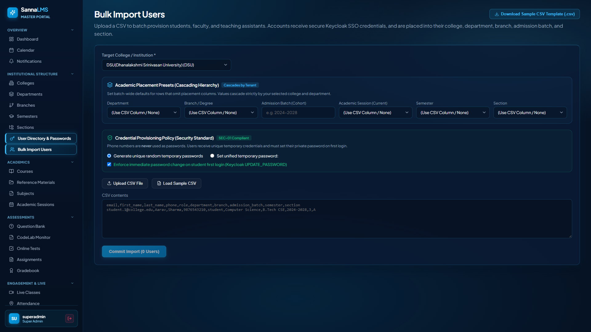
*Figure 6.1: Bulk Import Console with Cascading Placement Presets and Security Policy*

### Import Workflow
1. **Target College**: Select the destination institution.
2. **Academic Placement Presets**: Set batch-wide defaults for Department, Branch, Admission Batch, Session, Semester, and Section. Rows that omit these columns automatically inherit these presets.
3. **Credential Provisioning Policy**:
   - `Generate unique random temporary passwords` (Recommended for security).
   - `Set unified temporary password` (e.g. `Welcome@2026`).
   - Check `Enforce immediate password change on student first login`.
4. **Upload & Commit**: Drag and drop the `.csv` file or paste raw rows directly, then click **Commit Import**.

**Standard CSV Format:**
```csv
email,first_name,last_name,phone,role,department,branch,admission_batch,semester,section
student.1@college.edu,Aarav,Sharma,9876543210,student,Computer Science,B.Tech CSE,2024-2028,3,A
student.2@college.edu,Rohan,Verma,9876543211,student,Computer Science,B.Tech CSE,2024-2028,3,A
```

---

## 7. Courses, Curriculum & Study Materials

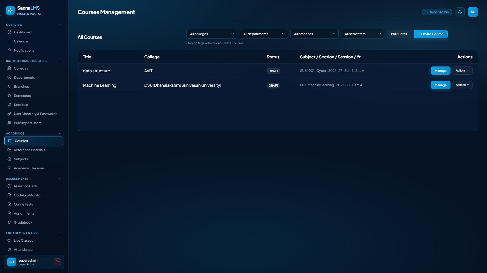
*Figure 7.1: Master Course Offerings Catalog with enrollment counters and status tags*

### Publishing a Course
1. Click **+ Add Course** and input Course Name, Code, Department, and Thumbnail.
2. Build syllabus modules, attach reading documents (PDFs, PPTs), and embed video lectures.
3. Toggle status from `DRAFT` to `PUBLISHED` to make it accessible to enrolled students.

---

## 8. Question Bank & Coding Problem Specification

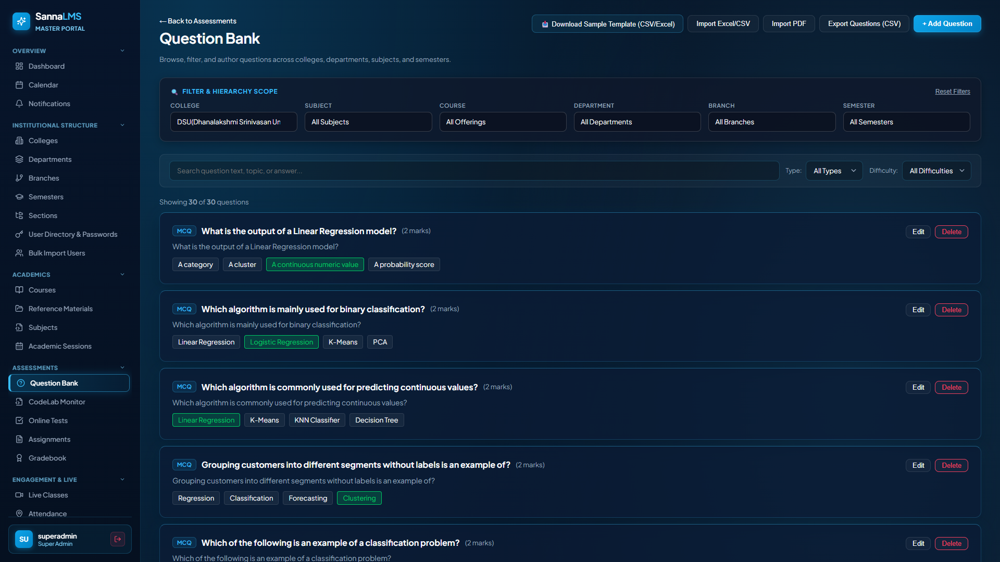
*Figure 8.1: Centralized Question Bank with College, Subject, and Course scoping filters*

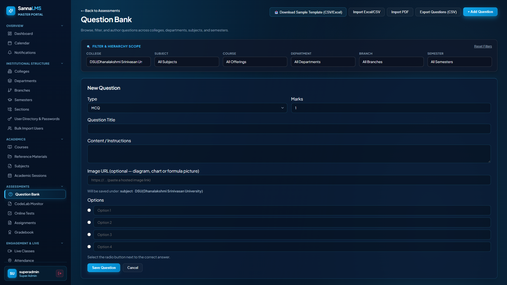
*Figure 8.2: Question Authoring Console with Type selection (MCQ vs Coding), Marks, and Options*

### Edulateral CodeLab Coding Problem Specifications
When creating programmatic challenges, configure:
- **Runtimes**: Python 3.10, C (GCC), C++ (G++), Java 17, JavaScript (Node.js 20), SQL (SQLite).
- **Execution Constraints**: Time limit (e.g. 2000ms), Memory ceiling (e.g. 256MB).
- **Test Cases**:
  - *Visible Test Cases*: Provided to students in the editor with sample inputs and expected outputs to facilitate debugging.
  - *Hidden Test Cases*: Evaluated only during final submission to verify edge cases and algorithmic time complexity.

---

## 9. Edulateral CodeLab Live Monitor & Plagiarism Reviewer

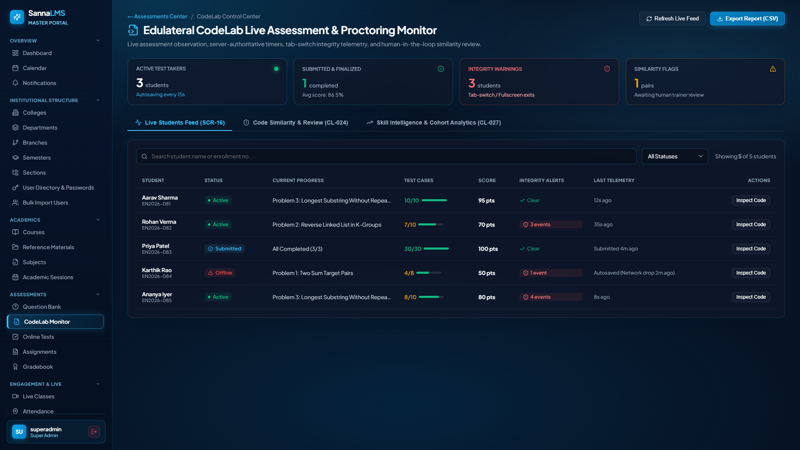
*Figure 9.1: Live Proctoring & Similarity Monitor showing active students, test case scores, and violation flags*

### Real-Time Examination Supervision
1. **Telemetry Feed**: Displays active test-takers, network health, current problem progress, and passing test cases (e.g., `10/10`).
2. **15-Second Autosave**: Student code buffers persist in Redis every 15 seconds. If a student experiences a network drop, their session restores instantly upon reconnection.
3. **Integrity Alerts**: Monitors tab switches, window blur events, and full-screen exits. Red alert badges indicate suspicious activity.
4. **Plagiarism Detection**: Analyzes token overlap using Jaccard similarity. Submissions with `>70%` similarity are flagged for human review with side-by-side AST code diffs.
5. **Exporting Reports**: Click **Export Report (CSV)** for comprehensive post-exam audit trails.

---

## 10. Online Tests, Quizzes & Assignments

| Online Quizzes | Subjective Assignments |
| :---: | :---: |
| 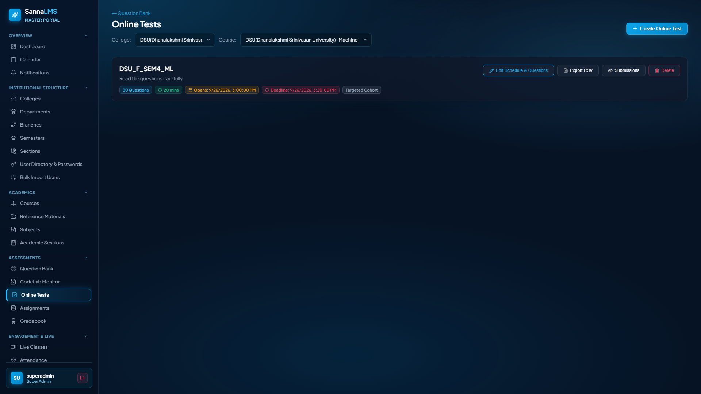 | 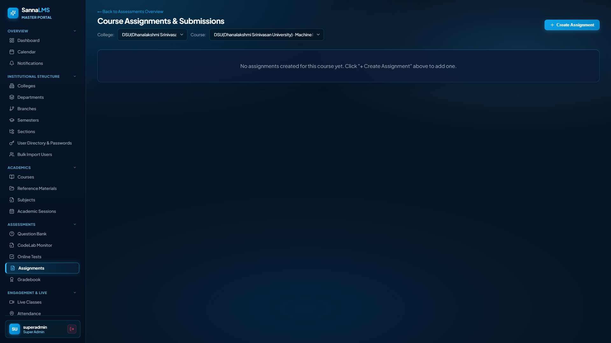 |

- **Quizzes**: Create timed tests with randomized question pools, negative marking, and automated instant grading.
- **Assignments**: Set due dates, submission file constraints (.zip, .pdf), and assign trainers or TAs to evaluate work against rubrics.

---

## 11. Master Gradebook & Performance Records

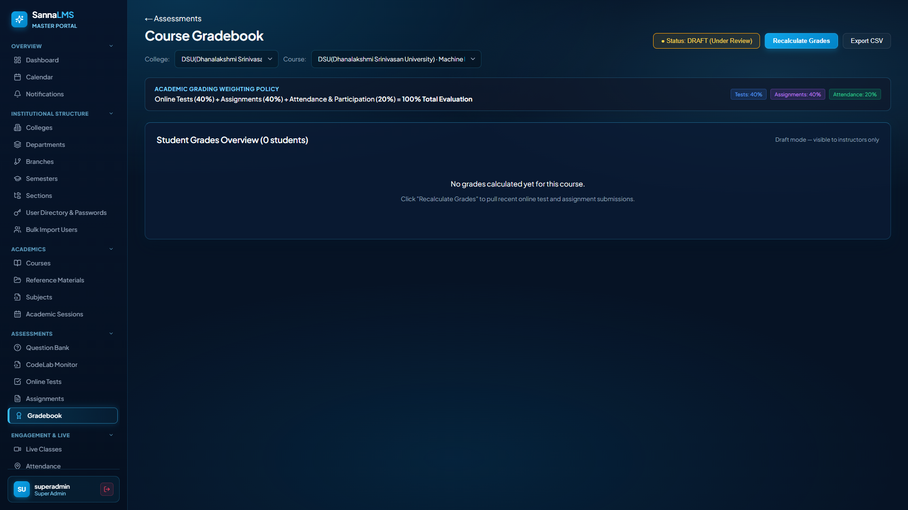
*Figure 11.1: Master Gradebook with student performance roll-ups and CSV export*

Aggregates scores across all quizzes, assignments, and CodeLab practicals. Data flows directly into each student's longitudinal skill record for placement eligibility screening.

---

## 12. Live Virtual Classes & Institutional Calendar

| Live Virtual Classes | Master Academic Calendar |
| :---: | :---: |
| 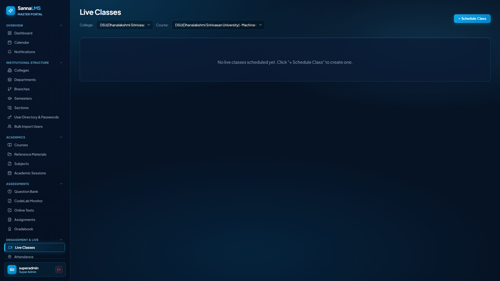 | 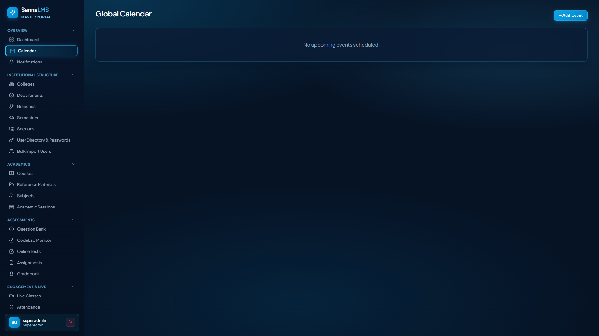 |

- **Live Classes**: Schedule interactive webinars and virtual lectures with WebRTC integration.
- **Calendar**: Maintain campus-wide examination schedules, submission cutoffs, and academic holidays.

---

## 13. Attendance Tracking & Digital Credentials

| Attendance Management | Certificate Designer |
| :---: | :---: |
| 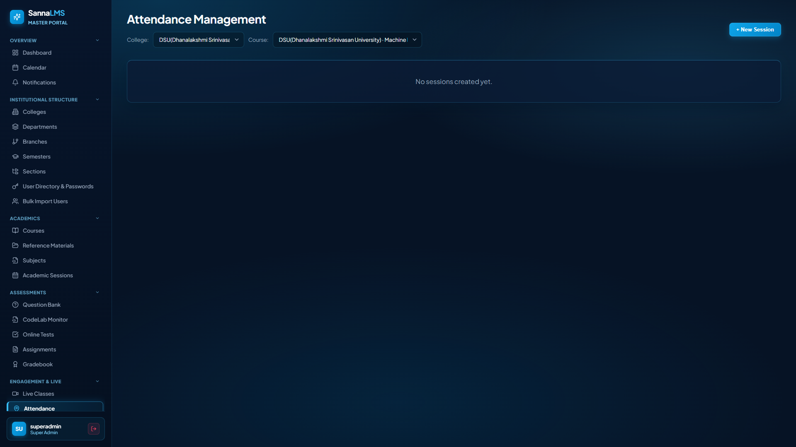 | 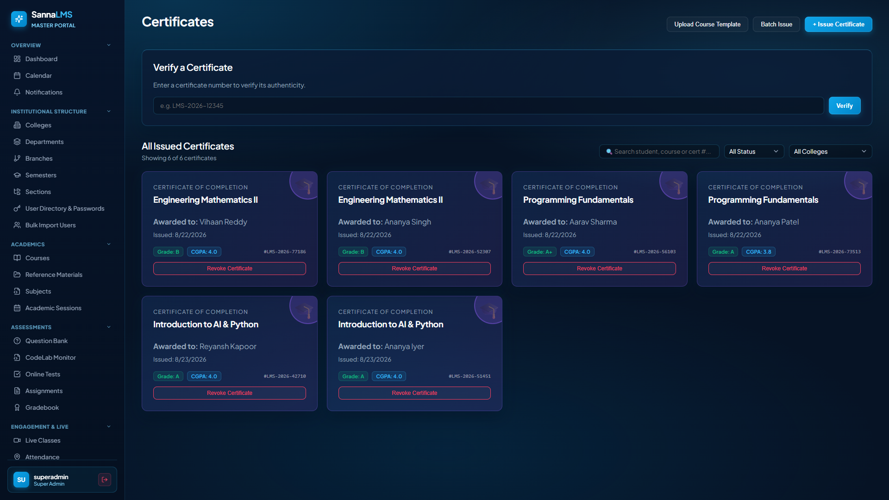 |

- **Attendance**: Track student attendance per course session with compliance status indicators.
- **Certificates**: Design digital completion credentials with verifiable QR codes and automated issuance upon course completion.

---

## 14. Broadcast Notifications & Discussion Moderation

| Broadcast Notifications | Discussion Forums |
| :---: | :---: |
| 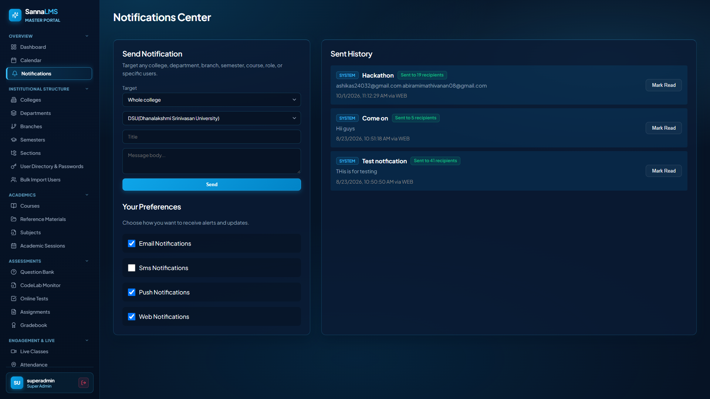 | 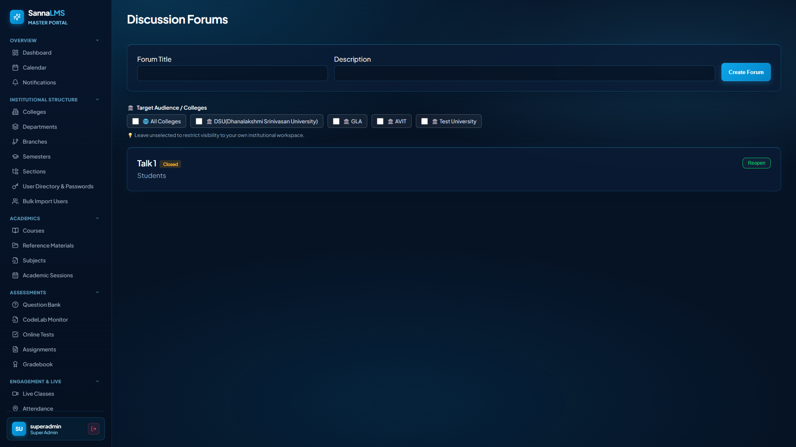 |

- **Notifications**: Broadcast system-wide announcements or campus-specific alerts.
- **Forums**: Moderate peer discussions, pin important instructional threads, and lock resolved topics.

---

*Document compiled from live production cluster `195.35.21.204`.*  
*To generate a PDF version, open [SUPERADMIN_USER_MANUAL.html](SUPERADMIN_USER_MANUAL.html) in any web browser and press `Ctrl + P` (`Cmd + P` on Mac).*
